# Evaluacion: reconstruccion vs ground truth

Generado 2026-11-23 11:56 con `./run.sh informe` a partir de `Reconstrucciones/*/*/evaluacion/metricas.json`. No editar a mano.

## Metodo

Todas las nubes estan en el marco del tablero ChArUco (mm). Antes de comparar, cada nube (`<tecnica>/resultado.ply`) se limpia igual para las 4 tecnicas (`recon/limpieza.py`, `configs/recon.yaml: limpieza`) y se guarda en `<tecnica>/resultado_limpio.ply`:

1. **ROI**: cilindro de radio 160 mm sobre el eje de la base.
2. **Piso**: plano del tablero ajustado con RANSAC (umbral 1.5 mm) en la propia nube, con los puntos con |z| < 10 mm de la corona exterior de la ROI (r > 0.75 R, donde nunca hay objeto). Si el ajuste es dudoso (inclinacion > 3 deg o a mas de 5 mm de z = 0) se usa z = 0. En la corona se mide el grosor del piso reconstruido (percentil 99 de la altura sobre el plano) y se quita todo lo que queda por debajo de **corte = max(5 mm, grosor + 1 mm)** (tope 10 mm).
3. **Outliers estadisticos**: distancia media a 20 vecinos > media + 2 sigma.
4. **Clusters flotantes**: DBSCAN (eps 4 mm sobre la nube a 1.5 mm); semilla = el mayor cluster que toca el piso (a < 10 mm del corte); se suman los que tengan >= 2% de los puntos y esten a < 15 mm; el resto son flotantes.

El GT es la malla del objeto colocada en la escena sintetica, muestreada uniformemente; la franja junto a su base (apoyada en el tablero, no observable) se excluye hasta la **misma altura del corte del piso de cada tecnica**, para no penalizar la completitud por el corte. En capturas reales la pose del objeto no se conoce: el GT se registra (barrido de yaw + ICP de 4 GDL: x, y, z, yaw, sin inclinar) sobre la nube limpia de CADA tecnica y se usa la pose con menor error mediano en el conjunto (consenso); esa pose sirve para todas las tecnicas. El marco del tablero lo fijan las camaras de color (ChArUco), asi que el consenso lo deciden las tecnicas RGB; un sesgo de la profundidad de las L515 aparece como error de profundidad *sin ICP* (y desaparece *con ICP*).

Metricas (mm): **precision** = distancia de cada punto reconstruido a la malla GT; **completitud** = distancia de cada punto del GT (muestreado) a la nube; **chamfer** = media de ambas medias; **F@t** = media armonica de la fraccion de puntos con precision < t y de GT con completitud < t. *Sin ICP* = en las poses de la captura (lo que importa); *con ICP* = tras alinear la nube al GT (separa error de forma de error de registro).

`*` = perfil rapido (pocas iteraciones; solo valida el flujo, no comparable).

## Resumen

Chamfer sin ICP (mm, menor = mejor):

| captura | profundidad | fotogrametria | gaussian | nerf |
|---|---:|---:|---:|---:|
| real/P1 | 1.96 | 1.59 | 2.24 | 1.56 |
| real/artefacto | 3.40 | 1.85 | 1.30 | 1.23 |
| real/bunny_x100 | 3.07 | 1.24 | 0.97 | 0.87 |
| real/bunny_x200 | 2.42 | 2.13 | 2.49 | 1.73 |
| real/cesar | 9.22 | 3.71 | 3.30 | 2.81 |
| sintetica/P1 | 0.27 | 1.80 | 1.36 | 0.83 |
| sintetica/artefacto | 0.30 | 2.07 | 1.68 | 1.21 |
| sintetica/bunny_x100 | 0.29 | 1.30 | 1.32 | 0.72 |
| sintetica/bunny_x200 | 0.26 | 1.86 | 3.07 | 1.70 |
| sintetica/cesar | 0.89 | 3.60 | 2.58 | 2.14 |

F-score a 2 mm sin ICP (mayor = mejor):

| captura | profundidad | fotogrametria | gaussian | nerf |
|---|---:|---:|---:|---:|
| real/P1 | 0.519 | 0.783 | 0.632 | 0.766 |
| real/artefacto | 0.312 | 0.639 | 0.823 | 0.825 |
| real/bunny_x100 | 0.382 | 0.843 | 0.922 | 0.930 |
| real/bunny_x200 | 0.463 | 0.759 | 0.652 | 0.788 |
| real/cesar | 0.189 | 0.635 | 0.462 | 0.623 |
| sintetica/P1 | 1.000 | 0.698 | 0.830 | 0.934 |
| sintetica/artefacto | 1.000 | 0.666 | 0.750 | 0.833 |
| sintetica/bunny_x100 | 0.999 | 0.820 | 0.861 | 0.966 |
| sintetica/bunny_x200 | 0.996 | 0.791 | 0.643 | 0.818 |
| sintetica/cesar | 0.916 | 0.684 | 0.641 | 0.719 |

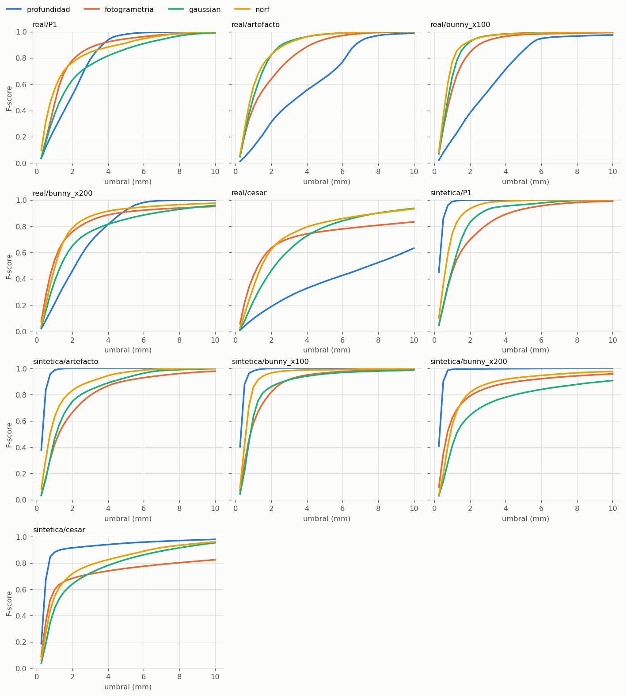

## Real vs sintetico (gemelo)

Cada captura real se compara con su gemelo (`./run.sh gemelo`: mismas poses de camara y de la base, mismo objeto, escala y material). Las dos se evaluan contra la MISMA malla GT; en la real va registrada por consenso (ver Metodo). La diferencia real - sintetico mide lo que el gemelo no reproduce (ruido y sesgo de las L515, iluminacion, material, calibracion).

Chamfer sin ICP (mm), real / sintetico:

| captura | profundidad real / sint | fotogrametria real / sint | gaussian real / sint | nerf real / sint |
|---|---:|---:|---:|---:|
| P1 | 1.96 / 0.27 | 1.59 / 1.80 | 2.24 / 1.36 | 1.56 / 0.83 |
| artefacto | 3.40 / 0.30 | 1.85 / 2.07 | 1.30 / 1.68 | 1.23 / 1.21 |
| bunny_x100 | 3.07 / 0.29 | 1.24 / 1.30 | 0.97 / 1.32 | 0.87 / 0.72 |
| bunny_x200 | 2.42 / 0.26 | 2.13 / 1.86 | 2.49 / 3.07 | 1.73 / 1.70 |
| cesar | 9.22 / 0.89 | 3.71 / 3.60 | 3.30 / 2.58 | 2.81 / 2.14 |
| **media real - sint** | +3.61 | -0.02 | +0.06 | +0.32 |

F@2mm sin ICP, real / sintetico:

| captura | profundidad real / sint | fotogrametria real / sint | gaussian real / sint | nerf real / sint |
|---|---:|---:|---:|---:|
| P1 | 0.519 / 1.000 | 0.783 / 0.698 | 0.632 / 0.830 | 0.766 / 0.934 |
| artefacto | 0.312 / 1.000 | 0.639 / 0.666 | 0.823 / 0.750 | 0.825 / 0.833 |
| bunny_x100 | 0.382 / 0.999 | 0.843 / 0.820 | 0.922 / 0.861 | 0.930 / 0.966 |
| bunny_x200 | 0.463 / 0.996 | 0.759 / 0.791 | 0.652 / 0.643 | 0.788 / 0.818 |
| cesar | 0.189 / 0.916 | 0.635 / 0.684 | 0.462 / 0.641 | 0.623 / 0.719 |
| **media real - sint** | -0.609 | +0.000 | -0.047 | -0.068 |

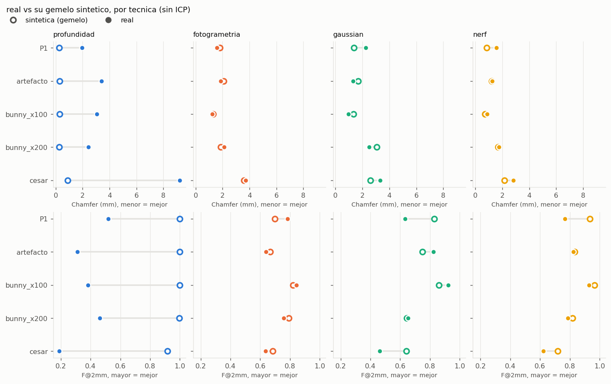

## real/P1

GT: `Captura_sintetica/P1/gt/objeto_rev.ply`; registrado por consenso, pose de gaussian (fitness 0.68, rmse 1.02 mm; error mediano por pose candidata: nerf 1.23, gaussian 1.09, fotogrametria 1.51, profundidad 1.93 mm)

| tecnica | pts ROI | corte piso | piso % | outl. % | flot. % | pts limpios | precision med | precision p90 | complet. med | complet. p90 | chamfer | hausdorff p95 | F@1mm | F@2mm | F@5mm | chamfer c/ICP | ICP mueve |
|---|---:|---:|---:|---:|---:|---:|---:|---:|---:|---:|---:|---:|---:|---:|---:|---:|---:|
| profundidad | 278505 | 5.0 | 86.8 | 0.0 | 0.0 | 36824 | 1.51 | 2.93 | 2.27 | 4.08 | 1.96 | 4.74 | 0.261 | 0.519 | 0.981 | 1.35 | 2.5 |
| fotogrametria | 208162 | 5.0 | 85.2 | 0.0 | 0.1 | 30699 | 1.04 | 2.53 | 1.12 | 4.38 | 1.59 | 6.18 | 0.454 | 0.783 | 0.946 | 1.30 | 1.2 |
| gaussian | 215716 | 5.0 | 87.3 | 0.7 | 2.9 | 19864 | 1.14 | 5.30 | 1.61 | 6.10 | 2.24 | 7.53 | 0.372 | 0.632 | 0.869 | 2.26 | 0.8 |
| nerf | 253529 | 5.0 | 84.6 | 0.0 | 0.0 | 38913 | 0.90 | 5.85 | 0.80 | 2.64 | 1.56 | 7.22 | 0.563 | 0.766 | 0.913 | 1.49 | 0.7 |

Plano del tablero ajustado por tecnica:

- profundidad: corte 5.0 mm (grosor del piso 0.7 mm), plano ransac, inclinacion 0.12 deg, z=0 a +2.73 mm del plano, rms 0.42 mm
- fotogrametria: corte 5.0 mm (grosor del piso 1.9 mm), plano ransac, inclinacion 0.19 deg, z=0 a -0.70 mm del plano, rms 0.68 mm
- gaussian: corte 5.0 mm (grosor del piso 2.5 mm), plano ransac, inclinacion 0.20 deg, z=0 a -2.34 mm del plano, rms 0.82 mm
- nerf: corte 5.0 mm (grosor del piso 2.0 mm), plano ransac, inclinacion 0.28 deg, z=0 a -0.39 mm del plano, rms 0.75 mm

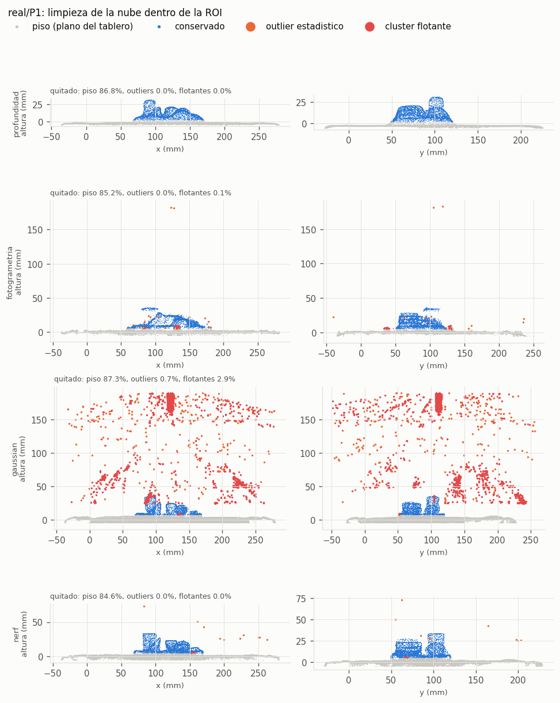

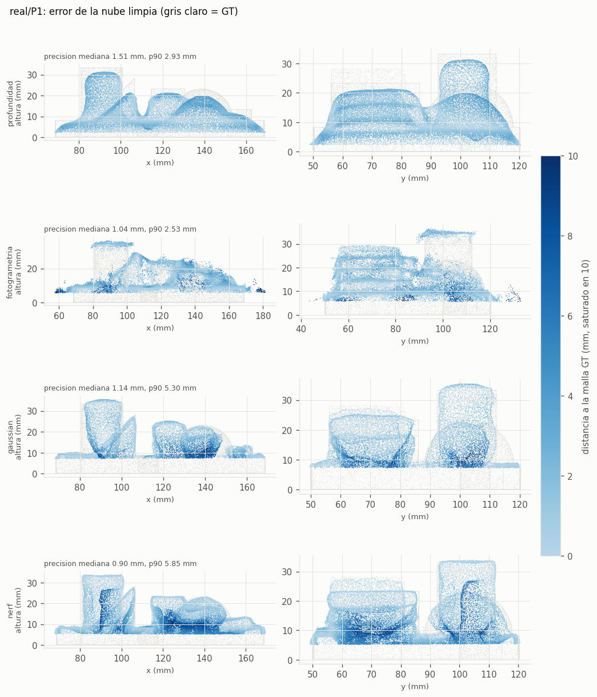

Nubes para MeshLab/CloudCompare: `Reconstrucciones/real/P1/evaluacion/<tecnica>_error.ply` (color = error) y `<tecnica>/resultado_limpio.ply`.

## real/artefacto

GT: `Captura_sintetica/artefacto/gt/objeto_rev.ply`; registrado por consenso, pose de nerf (fitness 0.80, rmse 1.01 mm; error mediano por pose candidata: nerf 1.04, gaussian 1.07, fotogrametria 1.84, profundidad 3.18 mm)

| tecnica | pts ROI | corte piso | piso % | outl. % | flot. % | pts limpios | precision med | precision p90 | complet. med | complet. p90 | chamfer | hausdorff p95 | F@1mm | F@2mm | F@5mm | chamfer c/ICP | ICP mueve |
|---|---:|---:|---:|---:|---:|---:|---:|---:|---:|---:|---:|---:|---:|---:|---:|---:|---:|
| profundidad | 280728 | 5.0 | 74.3 | 0.0 | 0.0 | 72113 | 1.89 | 3.84 | 5.08 | 7.27 | 3.40 | 8.18 | 0.123 | 0.312 | 0.649 | 1.20 | 6.4 |
| fotogrametria | 228060 | 5.0 | 73.3 | 0.2 | 0.0 | 60394 | 1.21 | 4.43 | 1.33 | 3.93 | 1.85 | 5.32 | 0.423 | 0.639 | 0.942 | 1.84 | 1.3 |
| gaussian | 226682 | 5.0 | 75.9 | 1.0 | 2.7 | 46169 | 0.86 | 2.40 | 1.11 | 2.71 | 1.30 | 3.60 | 0.500 | 0.823 | 0.980 | 1.28 | 0.4 |
| nerf | 234014 | 5.0 | 70.8 | 0.0 | 0.0 | 68204 | 0.79 | 3.06 | 0.88 | 2.51 | 1.23 | 4.14 | 0.582 | 0.825 | 0.982 | 1.22 | 0.2 |

Plano del tablero ajustado por tecnica:

- profundidad: corte 5.0 mm (grosor del piso 0.6 mm), plano ransac, inclinacion 0.11 deg, z=0 a +2.71 mm del plano, rms 0.39 mm
- fotogrametria: corte 5.0 mm (grosor del piso 1.7 mm), plano ransac, inclinacion 0.09 deg, z=0 a -0.67 mm del plano, rms 0.64 mm
- gaussian: corte 5.0 mm (grosor del piso 2.3 mm), plano ransac, inclinacion 0.18 deg, z=0 a -2.36 mm del plano, rms 0.84 mm
- nerf: corte 5.0 mm (grosor del piso 2.8 mm), plano ransac, inclinacion 0.10 deg, z=0 a -0.63 mm del plano, rms 0.72 mm

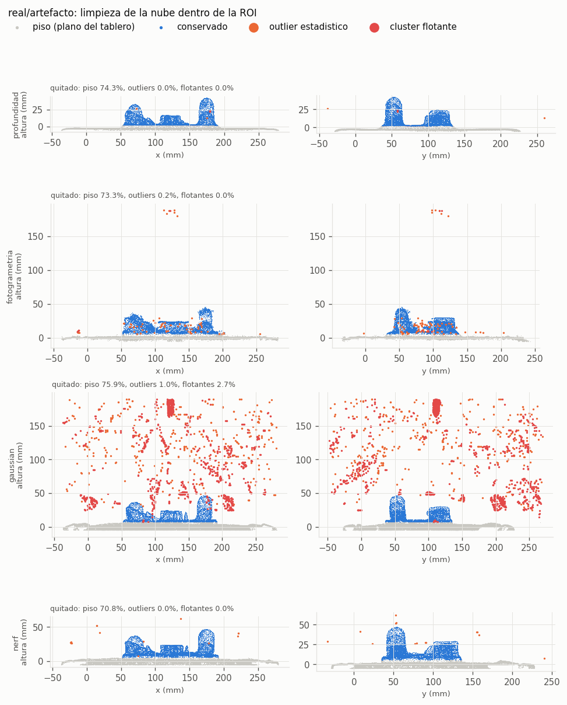

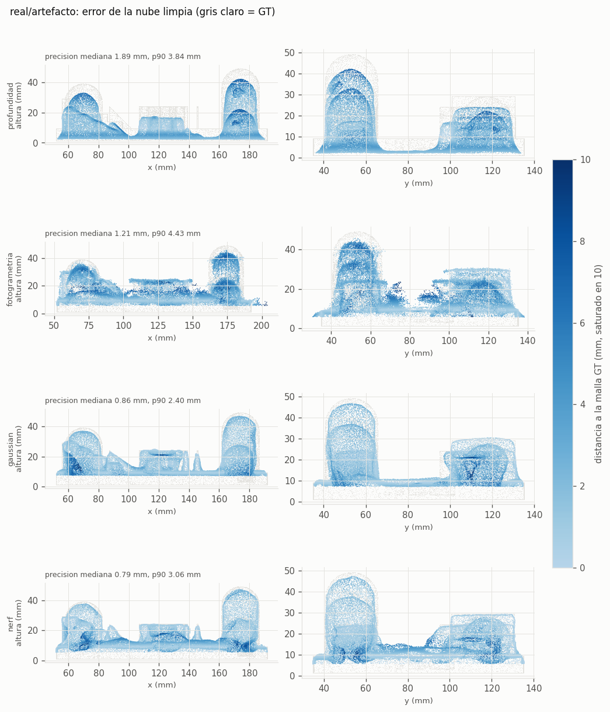

Nubes para MeshLab/CloudCompare: `Reconstrucciones/real/artefacto/evaluacion/<tecnica>_error.ply` (color = error) y `<tecnica>/resultado_limpio.ply`.

## real/bunny_x100

GT: `Captura_sintetica/bunny_x100/gt/objeto_rev.ply`; registrado por consenso, pose de nerf (fitness 0.91, rmse 0.78 mm; error mediano por pose candidata: nerf 0.73, gaussian 0.74, fotogrametria 0.81, profundidad 2.43 mm)

| tecnica | pts ROI | corte piso | piso % | outl. % | flot. % | pts limpios | precision med | precision p90 | complet. med | complet. p90 | chamfer | hausdorff p95 | F@1mm | F@2mm | F@5mm | chamfer c/ICP | ICP mueve |
|---|---:|---:|---:|---:|---:|---:|---:|---:|---:|---:|---:|---:|---:|---:|---:|---:|---:|
| profundidad | 275542 | 5.0 | 85.4 | 0.0 | 0.3 | 39223 | 2.30 | 4.78 | 3.08 | 5.83 | 3.07 | 9.82 | 0.180 | 0.382 | 0.857 | 1.86 | 5.9 |
| fotogrametria | 212967 | 5.0 | 87.1 | 0.1 | 0.1 | 27232 | 0.75 | 2.12 | 0.99 | 2.92 | 1.24 | 4.26 | 0.558 | 0.843 | 0.978 | 1.24 | 0.3 |
| gaussian | 214150 | 5.0 | 83.9 | 1.0 | 2.0 | 28012 | 0.71 | 1.88 | 0.82 | 1.74 | 0.97 | 2.79 | 0.653 | 0.922 | 0.989 | 0.96 | 0.3 |
| nerf | 195808 | 5.0 | 85.9 | 0.0 | 0.0 | 27491 | 0.57 | 1.87 | 0.68 | 1.42 | 0.87 | 3.06 | 0.770 | 0.930 | 0.986 | 0.86 | 0.2 |

Plano del tablero ajustado por tecnica:

- profundidad: corte 5.0 mm (grosor del piso 0.6 mm), plano ransac, inclinacion 0.15 deg, z=0 a +2.90 mm del plano, rms 0.42 mm
- fotogrametria: corte 5.0 mm (grosor del piso 2.0 mm), plano ransac, inclinacion 0.20 deg, z=0 a -0.55 mm del plano, rms 0.68 mm
- gaussian: corte 5.0 mm (grosor del piso 2.9 mm), plano ransac, inclinacion 0.24 deg, z=0 a -1.44 mm del plano, rms 0.86 mm
- nerf: corte 5.0 mm (grosor del piso 2.1 mm), plano ransac, inclinacion 0.26 deg, z=0 a -0.25 mm del plano, rms 0.79 mm

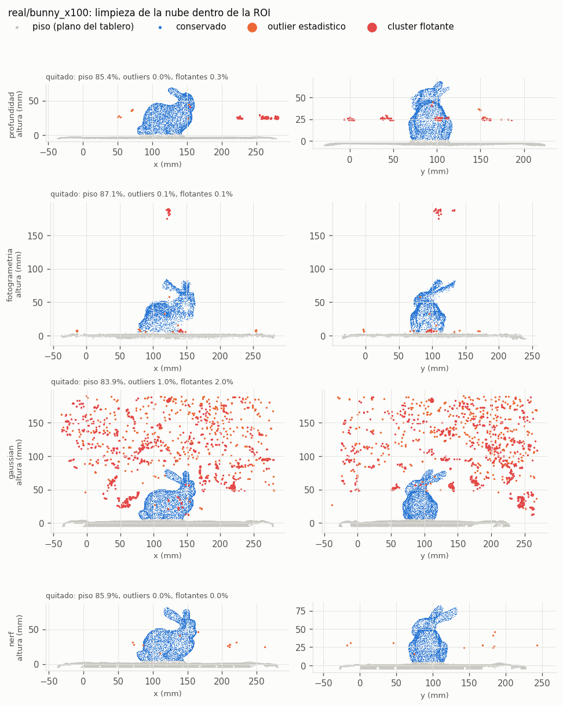

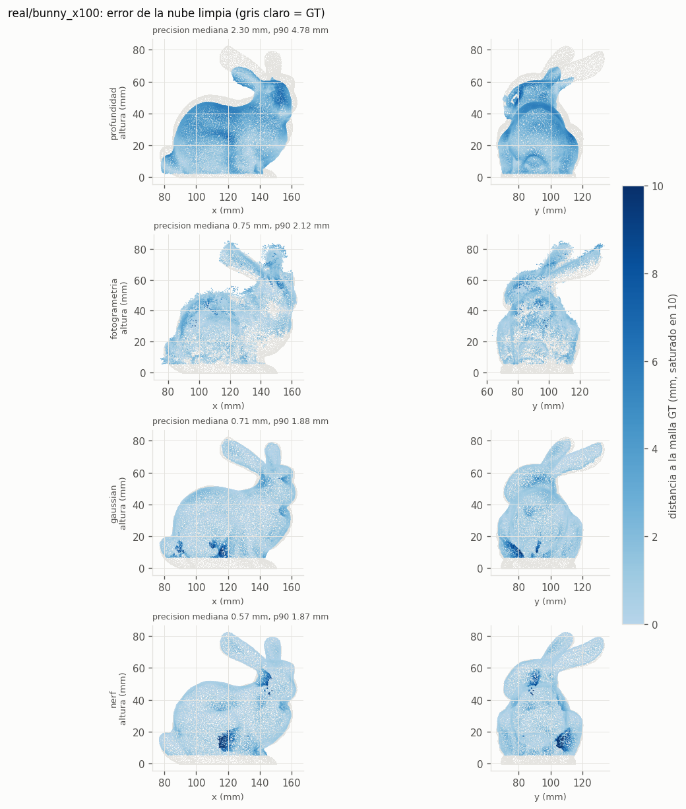

Nubes para MeshLab/CloudCompare: `Reconstrucciones/real/bunny_x100/evaluacion/<tecnica>_error.ply` (color = error) y `<tecnica>/resultado_limpio.ply`.

## real/bunny_x200

GT: `Captura_sintetica/bunny_x200/gt/objeto_rev.ply`; registrado por consenso, pose de nerf (fitness 0.72, rmse 1.11 mm; error mediano por pose candidata: nerf 1.29, gaussian 1.29, fotogrametria 1.32, profundidad 2.46 mm)

| tecnica | pts ROI | corte piso | piso % | outl. % | flot. % | pts limpios | precision med | precision p90 | complet. med | complet. p90 | chamfer | hausdorff p95 | F@1mm | F@2mm | F@5mm | chamfer c/ICP | ICP mueve |
|---|---:|---:|---:|---:|---:|---:|---:|---:|---:|---:|---:|---:|---:|---:|---:|---:|---:|
| profundidad | 281731 | 5.0 | 49.6 | 0.1 | 1.0 | 138820 | 2.15 | 4.83 | 2.16 | 4.70 | 2.42 | 5.47 | 0.212 | 0.463 | 0.922 | 1.67 | 5.1 |
| fotogrametria | 275247 | 5.0 | 56.8 | 0.5 | 0.4 | 116552 | 0.68 | 2.39 | 1.09 | 9.25 | 2.13 | 15.80 | 0.544 | 0.759 | 0.910 | 2.12 | 0.2 |
| gaussian | 241880 | 5.0 | 55.0 | 0.4 | 2.6 | 101429 | 1.50 | 8.75 | 1.23 | 3.93 | 2.49 | 11.64 | 0.382 | 0.652 | 0.855 | 2.49 | 0.1 |
| nerf | 241702 | 5.0 | 52.3 | 0.1 | 0.0 | 114976 | 1.08 | 5.68 | 1.00 | 2.35 | 1.73 | 9.44 | 0.484 | 0.788 | 0.935 | 1.73 | 0.2 |

Plano del tablero ajustado por tecnica:

- profundidad: corte 5.0 mm (grosor del piso 0.6 mm), plano ransac, inclinacion 0.03 deg, z=0 a +3.24 mm del plano, rms 0.36 mm
- fotogrametria: corte 5.0 mm (grosor del piso 1.7 mm), plano ransac, inclinacion 0.07 deg, z=0 a -0.37 mm del plano, rms 0.66 mm
- gaussian: corte 5.0 mm (grosor del piso 2.9 mm), plano ransac, inclinacion 0.20 deg, z=0 a -2.10 mm del plano, rms 0.86 mm
- nerf: corte 5.0 mm (grosor del piso 2.7 mm), plano ransac, inclinacion 0.09 deg, z=0 a -0.21 mm del plano, rms 0.75 mm

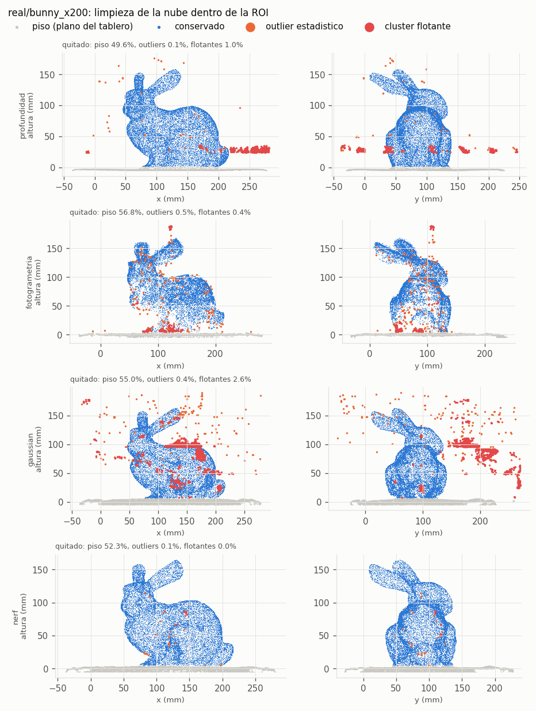

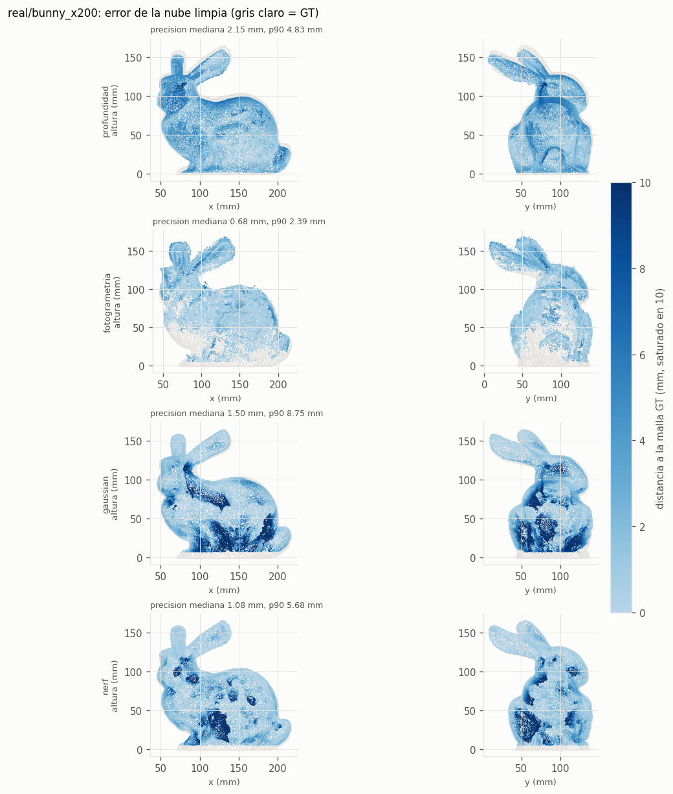

Nubes para MeshLab/CloudCompare: `Reconstrucciones/real/bunny_x200/evaluacion/<tecnica>_error.ply` (color = error) y `<tecnica>/resultado_limpio.ply`.

## real/cesar

GT: `Captura_sintetica/cesar/gt/objeto_rev.ply`; registrado por consenso, pose de nerf (fitness 0.64, rmse 1.25 mm; error mediano por pose candidata: nerf 1.59, gaussian 1.60, fotogrametria 1.62, profundidad 4.71 mm)

| tecnica | pts ROI | corte piso | piso % | outl. % | flot. % | pts limpios | precision med | precision p90 | complet. med | complet. p90 | chamfer | hausdorff p95 | F@1mm | F@2mm | F@5mm | chamfer c/ICP | ICP mueve |
|---|---:|---:|---:|---:|---:|---:|---:|---:|---:|---:|---:|---:|---:|---:|---:|---:|---:|
| profundidad | 245125 | 5.0 | 52.5 | 0.1 | 0.1 | 115934 | 4.01 | 10.76 | 10.03 | 35.72 | 9.22 | 47.10 | 0.097 | 0.189 | 0.380 | 9.00 | 16.1 |
| fotogrametria | 272882 | 5.0 | 57.4 | 0.4 | 0.2 | 114860 | 0.63 | 1.88 | 2.16 | 19.37 | 3.71 | 22.63 | 0.424 | 0.635 | 0.764 | 3.71 | 0.4 |
| gaussian | 234928 | 5.0 | 57.5 | 0.9 | 0.9 | 95820 | 1.89 | 6.20 | 2.49 | 9.47 | 3.30 | 12.30 | 0.229 | 0.462 | 0.796 | 3.33 | 1.0 |
| nerf | 269274 | 5.0 | 47.0 | 0.1 | 0.0 | 142409 | 1.29 | 5.43 | 1.63 | 10.32 | 2.81 | 12.99 | 0.336 | 0.623 | 0.832 | 2.80 | 0.2 |

Plano del tablero ajustado por tecnica:

- profundidad: corte 5.0 mm (grosor del piso 0.5 mm), plano ransac, inclinacion 0.05 deg, z=0 a +3.42 mm del plano, rms 0.39 mm
- fotogrametria: corte 5.0 mm (grosor del piso 2.2 mm), plano ransac, inclinacion 0.06 deg, z=0 a -0.33 mm del plano, rms 0.69 mm
- gaussian: corte 5.0 mm (grosor del piso 3.9 mm), plano ransac, inclinacion 0.25 deg, z=0 a -1.42 mm del plano, rms 0.84 mm
- nerf: corte 5.0 mm (grosor del piso 2.0 mm), plano ransac, inclinacion 0.03 deg, z=0 a -0.52 mm del plano, rms 0.75 mm

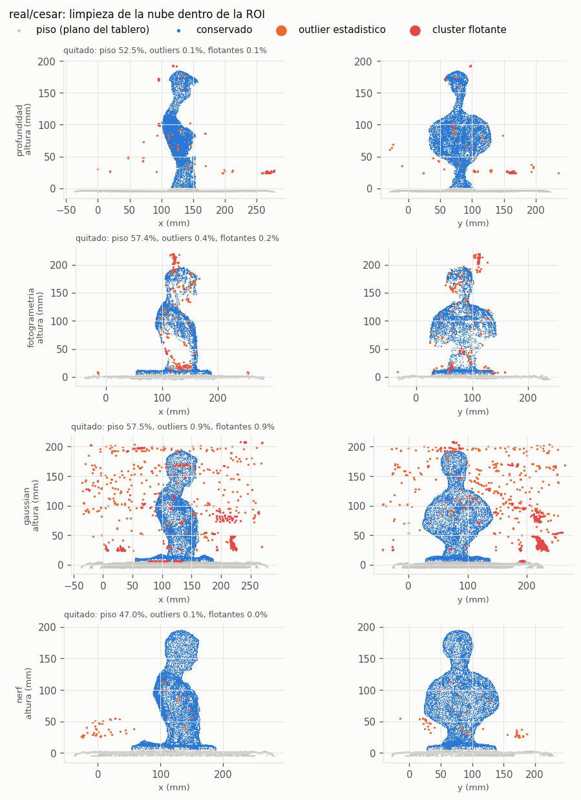

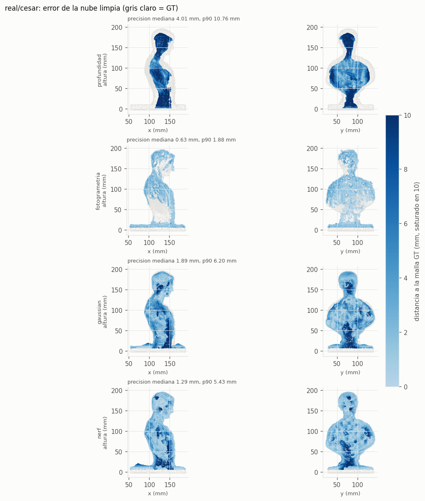

Nubes para MeshLab/CloudCompare: `Reconstrucciones/real/cesar/evaluacion/<tecnica>_error.ply` (color = error) y `<tecnica>/resultado_limpio.ply`.

## sintetica/P1

GT: `Captura_sintetica/P1/gt/objeto_rev.ply`

| tecnica | pts ROI | corte piso | piso % | outl. % | flot. % | pts limpios | precision med | precision p90 | complet. med | complet. p90 | chamfer | hausdorff p95 | F@1mm | F@2mm | F@5mm | chamfer c/ICP | ICP mueve |
|---|---:|---:|---:|---:|---:|---:|---:|---:|---:|---:|---:|---:|---:|---:|---:|---:|---:|
| profundidad | 279245 | 5.0 | 84.0 | 0.4 | 0.0 | 43415 | 0.11 | 0.42 | 0.33 | 0.65 | 0.27 | 0.80 | 0.988 | 1.000 | 1.000 | 0.27 | 0.1 |
| fotogrametria | 165222 | 5.0 | 82.6 | 0.7 | 0.0 | 27587 | 1.04 | 3.34 | 1.22 | 4.94 | 1.80 | 6.69 | 0.454 | 0.698 | 0.932 | 1.65 | 1.1 |
| gaussian | 216750 | 5.0 | 84.2 | 0.6 | 4.4 | 23338 | 0.99 | 2.63 | 1.11 | 2.56 | 1.36 | 4.73 | 0.471 | 0.830 | 0.965 | 1.19 | 1.1 |
| nerf | 277892 | 5.0 | 84.3 | 0.0 | 0.0 | 43659 | 0.62 | 1.75 | 0.68 | 1.56 | 0.83 | 2.41 | 0.744 | 0.934 | 0.997 | 0.76 | 0.6 |

Plano del tablero ajustado por tecnica:

- profundidad: corte 5.0 mm (grosor del piso 0.2 mm), plano ransac, inclinacion 0.01 deg, z=0 a +0.05 mm del plano, rms 0.23 mm
- fotogrametria: corte 5.0 mm (grosor del piso 1.9 mm), plano ransac, inclinacion 0.06 deg, z=0 a -1.06 mm del plano, rms 0.57 mm
- gaussian: corte 5.0 mm (grosor del piso 3.4 mm), plano ransac, inclinacion 0.34 deg, z=0 a -2.92 mm del plano, rms 0.83 mm
- nerf: corte 5.0 mm (grosor del piso 0.9 mm), plano ransac, inclinacion 0.08 deg, z=0 a -0.37 mm del plano, rms 0.38 mm

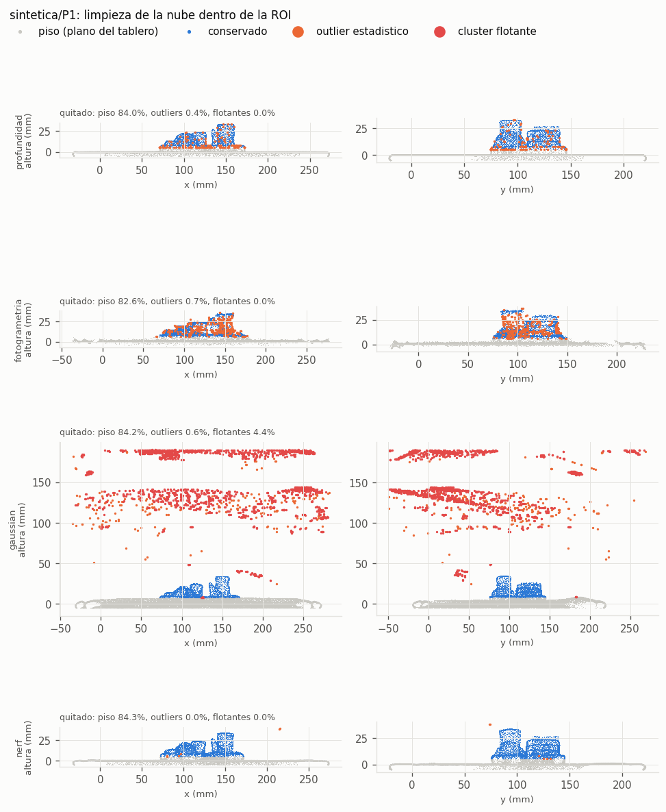

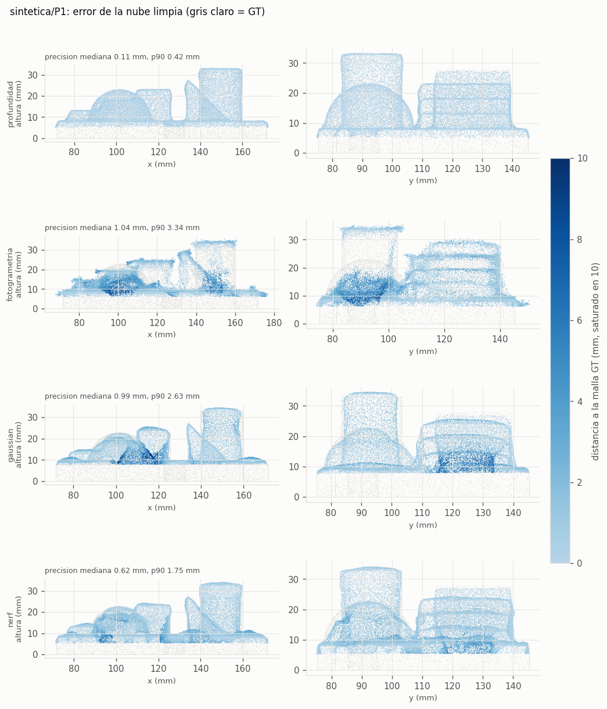

Nubes para MeshLab/CloudCompare: `Reconstrucciones/sintetica/P1/evaluacion/<tecnica>_error.ply` (color = error) y `<tecnica>/resultado_limpio.ply`.

## sintetica/artefacto

GT: `Captura_sintetica/artefacto/gt/objeto_rev.ply`

| tecnica | pts ROI | corte piso | piso % | outl. % | flot. % | pts limpios | precision med | precision p90 | complet. med | complet. p90 | chamfer | hausdorff p95 | F@1mm | F@2mm | F@5mm | chamfer c/ICP | ICP mueve |
|---|---:|---:|---:|---:|---:|---:|---:|---:|---:|---:|---:|---:|---:|---:|---:|---:|---:|
| profundidad | 279672 | 5.0 | 68.1 | 0.8 | 0.0 | 86968 | 0.14 | 0.46 | 0.35 | 0.66 | 0.30 | 0.80 | 0.987 | 1.000 | 1.000 | 0.29 | 0.1 |
| fotogrametria | 173582 | 5.0 | 69.2 | 0.1 | 0.0 | 53238 | 1.12 | 3.61 | 1.34 | 6.62 | 2.07 | 9.29 | 0.423 | 0.666 | 0.906 | 1.99 | 0.9 |
| gaussian | 243033 | 5.0 | 65.7 | 0.8 | 17.7 | 38511 | 0.90 | 3.90 | 1.21 | 4.42 | 1.68 | 5.62 | 0.466 | 0.750 | 0.929 | 1.47 | 1.0 |
| nerf | 279990 | 5.0 | 68.6 | 0.7 | 0.1 | 85887 | 0.71 | 3.43 | 0.77 | 2.64 | 1.21 | 4.68 | 0.633 | 0.833 | 0.971 | 1.10 | 0.7 |

Plano del tablero ajustado por tecnica:

- profundidad: corte 5.0 mm (grosor del piso 0.2 mm), plano ransac, inclinacion 0.03 deg, z=0 a -0.03 mm del plano, rms 0.29 mm
- fotogrametria: corte 5.0 mm (grosor del piso 1.9 mm), plano ransac, inclinacion 0.05 deg, z=0 a -0.99 mm del plano, rms 0.57 mm
- gaussian: corte 5.0 mm (grosor del piso 3.2 mm), plano ransac, inclinacion 0.38 deg, z=0 a -3.60 mm del plano, rms 0.80 mm
- nerf: corte 5.0 mm (grosor del piso 2.1 mm), plano ransac, inclinacion 0.13 deg, z=0 a -0.47 mm del plano, rms 0.52 mm

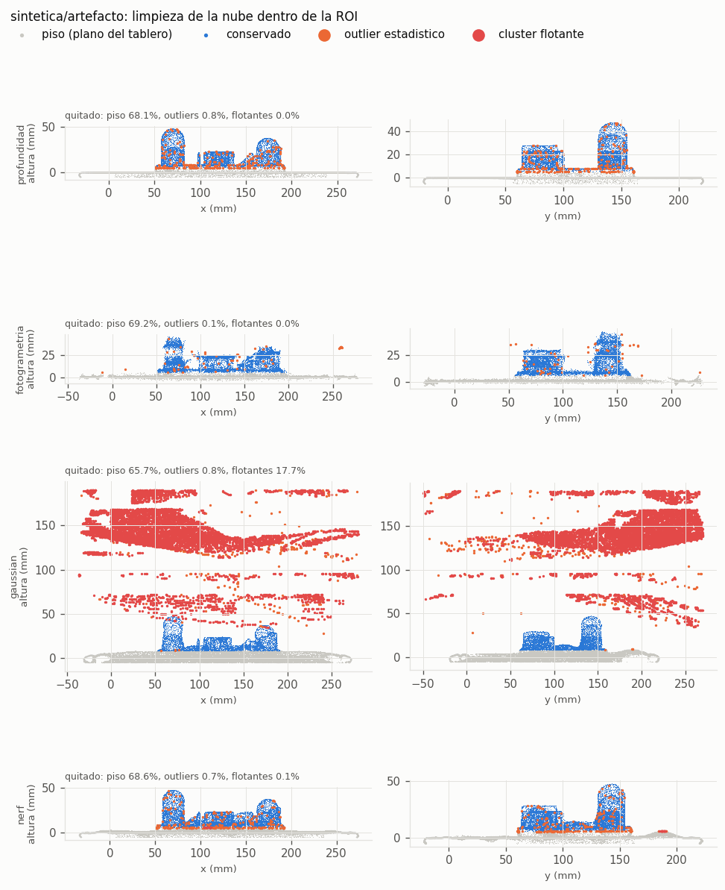

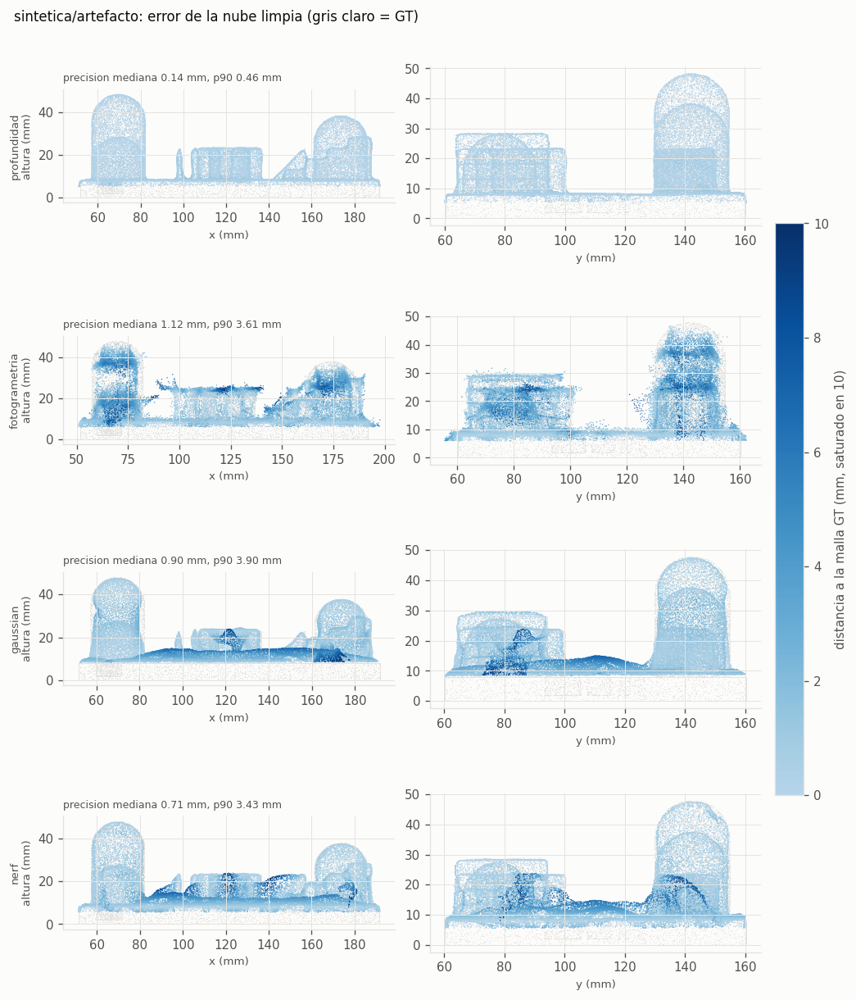

Nubes para MeshLab/CloudCompare: `Reconstrucciones/sintetica/artefacto/evaluacion/<tecnica>_error.ply` (color = error) y `<tecnica>/resultado_limpio.ply`.

## sintetica/bunny_x100

GT: `Captura_sintetica/bunny_x100/gt/objeto_rev.ply`

| tecnica | pts ROI | corte piso | piso % | outl. % | flot. % | pts limpios | precision med | precision p90 | complet. med | complet. p90 | chamfer | hausdorff p95 | F@1mm | F@2mm | F@5mm | chamfer c/ICP | ICP mueve |
|---|---:|---:|---:|---:|---:|---:|---:|---:|---:|---:|---:|---:|---:|---:|---:|---:|---:|
| profundidad | 279849 | 5.0 | 83.2 | 0.4 | 0.0 | 45933 | 0.14 | 0.41 | 0.33 | 0.59 | 0.29 | 0.73 | 0.981 | 0.999 | 1.000 | 0.28 | 0.1 |
| fotogrametria | 158518 | 5.0 | 82.7 | 0.1 | 0.0 | 27230 | 0.73 | 2.23 | 0.90 | 3.61 | 1.30 | 5.63 | 0.583 | 0.820 | 0.966 | 1.30 | 0.6 |
| gaussian | 247971 | 5.0 | 70.2 | 0.8 | 16.9 | 29765 | 0.79 | 3.66 | 0.84 | 2.02 | 1.32 | 6.68 | 0.635 | 0.861 | 0.958 | 1.28 | 0.5 |
| nerf | 266997 | 5.0 | 83.2 | 0.3 | 0.0 | 44202 | 0.51 | 1.31 | 0.59 | 1.09 | 0.72 | 2.14 | 0.859 | 0.966 | 0.990 | 0.67 | 0.5 |

Plano del tablero ajustado por tecnica:

- profundidad: corte 5.0 mm (grosor del piso 0.2 mm), plano ransac, inclinacion 0.03 deg, z=0 a -0.02 mm del plano, rms 0.31 mm
- fotogrametria: corte 5.0 mm (grosor del piso 1.8 mm), plano ransac, inclinacion 0.01 deg, z=0 a -1.01 mm del plano, rms 0.55 mm
- gaussian: corte 5.0 mm (grosor del piso 3.7 mm), plano ransac, inclinacion 0.31 deg, z=0 a -2.89 mm del plano, rms 0.81 mm
- nerf: corte 5.0 mm (grosor del piso 0.8 mm), plano ransac, inclinacion 0.07 deg, z=0 a -0.40 mm del plano, rms 0.49 mm

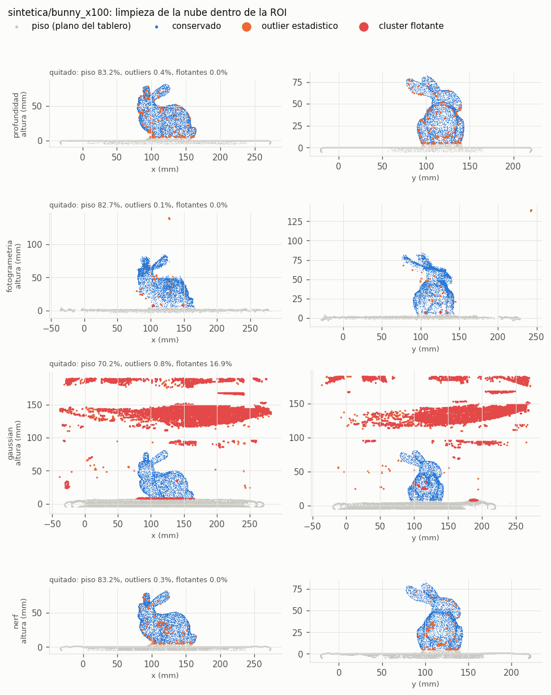

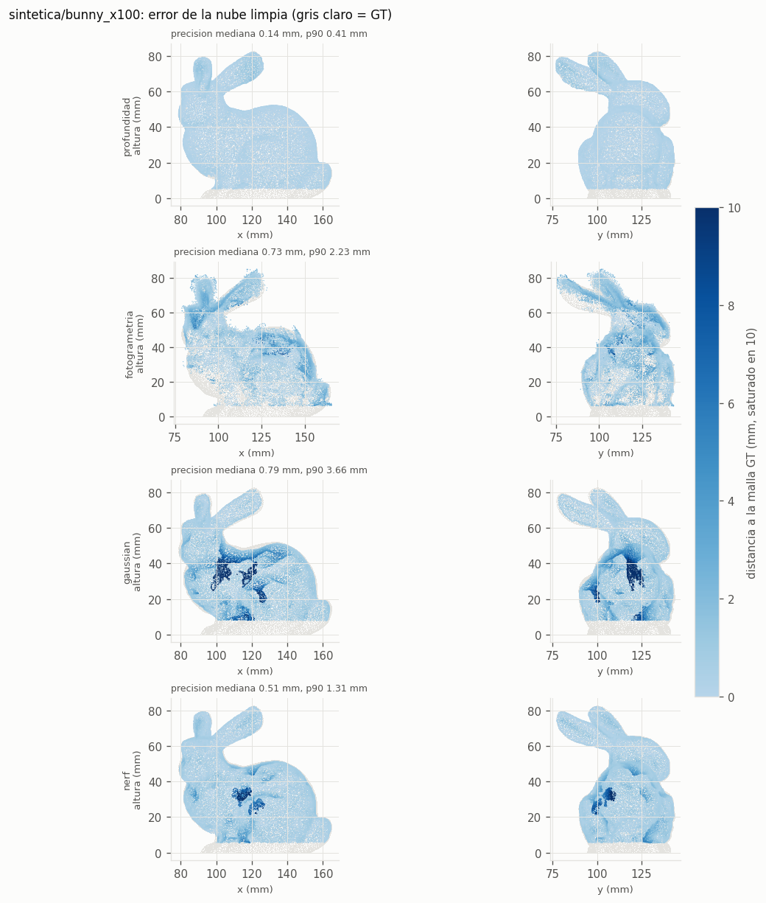

Nubes para MeshLab/CloudCompare: `Reconstrucciones/sintetica/bunny_x100/evaluacion/<tecnica>_error.ply` (color = error) y `<tecnica>/resultado_limpio.ply`.

## sintetica/bunny_x200

GT: `Captura_sintetica/bunny_x200/gt/objeto_rev.ply`

| tecnica | pts ROI | corte piso | piso % | outl. % | flot. % | pts limpios | precision med | precision p90 | complet. med | complet. p90 | chamfer | hausdorff p95 | F@1mm | F@2mm | F@5mm | chamfer c/ICP | ICP mueve |
|---|---:|---:|---:|---:|---:|---:|---:|---:|---:|---:|---:|---:|---:|---:|---:|---:|---:|
| profundidad | 286692 | 5.0 | 52.3 | 0.8 | 0.0 | 134655 | 0.11 | 0.26 | 0.34 | 0.57 | 0.26 | 0.65 | 0.993 | 0.996 | 0.998 | 0.25 | 0.2 |
| fotogrametria | 220659 | 5.0 | 46.5 | 1.4 | 0.6 | 113610 | 0.53 | 1.88 | 0.87 | 8.50 | 1.86 | 13.48 | 0.623 | 0.791 | 0.907 | 1.86 | 0.2 |
| gaussian | 254793 | 5.0 | 36.3 | 0.4 | 29.1 | 86941 | 1.53 | 13.42 | 1.09 | 3.60 | 3.07 | 17.43 | 0.410 | 0.643 | 0.814 | 3.05 | 0.2 |
| nerf | 268208 | 5.0 | 50.9 | 0.6 | 0.3 | 129256 | 0.90 | 5.91 | 0.86 | 2.14 | 1.70 | 9.34 | 0.570 | 0.818 | 0.934 | 1.63 | 0.8 |

Plano del tablero ajustado por tecnica:

- profundidad: corte 5.0 mm (grosor del piso 0.2 mm), plano ransac, inclinacion 0.02 deg, z=0 a -0.07 mm del plano, rms 0.26 mm
- fotogrametria: corte 5.0 mm (grosor del piso 1.7 mm), plano ransac, inclinacion 0.09 deg, z=0 a -0.76 mm del plano, rms 0.54 mm
- gaussian: corte 5.0 mm (grosor del piso 3.3 mm), plano ransac, inclinacion 0.21 deg, z=0 a -3.35 mm del plano, rms 0.76 mm
- nerf: corte 5.0 mm (grosor del piso 3.9 mm), plano ransac, inclinacion 0.01 deg, z=0 a -0.55 mm del plano, rms 0.61 mm

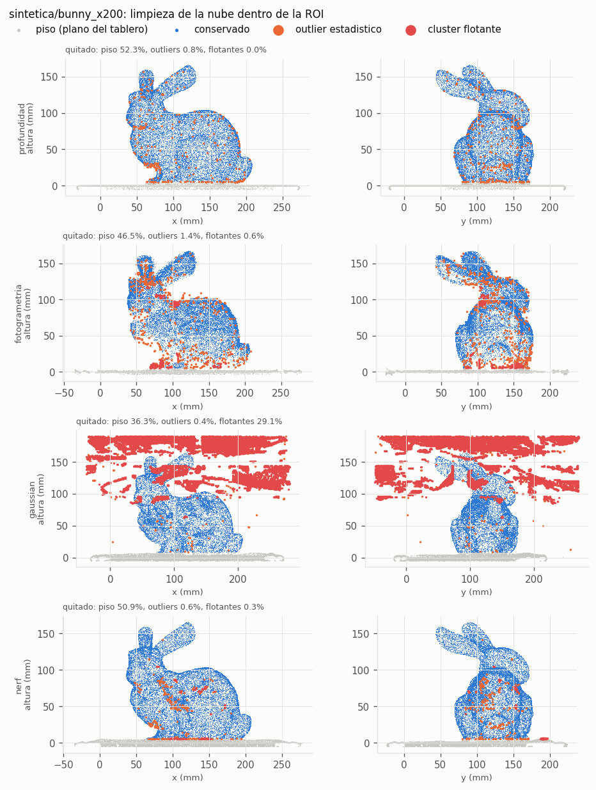

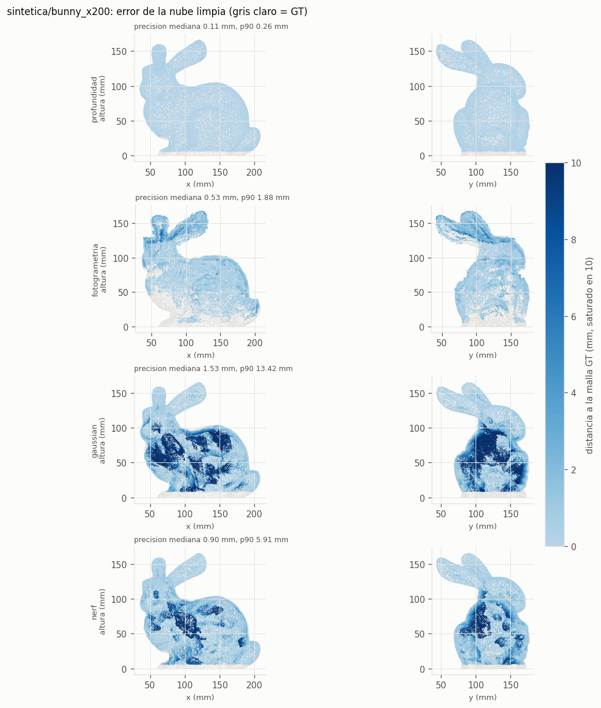

Nubes para MeshLab/CloudCompare: `Reconstrucciones/sintetica/bunny_x200/evaluacion/<tecnica>_error.ply` (color = error) y `<tecnica>/resultado_limpio.ply`.

## sintetica/cesar

GT: `Captura_sintetica/cesar/gt/objeto_rev.ply`

| tecnica | pts ROI | corte piso | piso % | outl. % | flot. % | pts limpios | precision med | precision p90 | complet. med | complet. p90 | chamfer | hausdorff p95 | F@1mm | F@2mm | F@5mm | chamfer c/ICP | ICP mueve |
|---|---:|---:|---:|---:|---:|---:|---:|---:|---:|---:|---:|---:|---:|---:|---:|---:|---:|
| profundidad | 287420 | 5.0 | 44.8 | 1.0 | 0.2 | 155301 | 0.23 | 0.52 | 0.48 | 4.58 | 0.89 | 8.66 | 0.883 | 0.916 | 0.952 | 0.83 | 0.3 |
| fotogrametria | 211006 | 5.0 | 45.2 | 1.0 | 0.1 | 113465 | 0.37 | 1.04 | 1.50 | 20.38 | 3.60 | 23.53 | 0.599 | 0.684 | 0.759 | 3.57 | 0.4 |
| gaussian | 262478 | 5.0 | 39.4 | 0.8 | 21.6 | 100346 | 1.02 | 6.24 | 1.25 | 8.34 | 2.58 | 10.65 | 0.456 | 0.641 | 0.827 | 2.58 | 0.2 |
| nerf | 290390 | 5.3 | 43.6 | 0.5 | 0.1 | 162029 | 0.81 | 5.29 | 0.92 | 8.26 | 2.14 | 11.00 | 0.548 | 0.719 | 0.859 | 2.13 | 0.3 |

Plano del tablero ajustado por tecnica:

- profundidad: corte 5.0 mm (grosor del piso 0.2 mm), plano ransac, inclinacion 0.01 deg, z=0 a -0.19 mm del plano, rms 0.22 mm
- fotogrametria: corte 5.0 mm (grosor del piso 1.6 mm), plano ransac, inclinacion 0.02 deg, z=0 a -0.65 mm del plano, rms 0.51 mm
- gaussian: corte 5.0 mm (grosor del piso 2.7 mm), plano ransac, inclinacion 0.10 deg, z=0 a -3.32 mm del plano, rms 0.79 mm
- nerf: corte 5.3 mm (grosor del piso 4.3 mm), plano ransac, inclinacion 0.07 deg, z=0 a -0.50 mm del plano, rms 0.54 mm

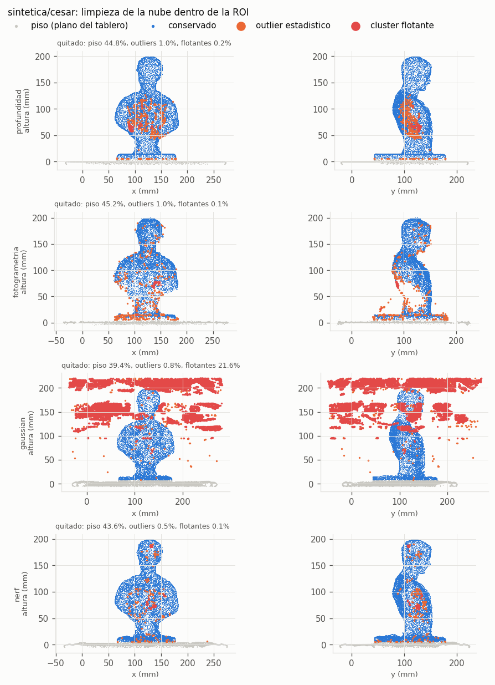

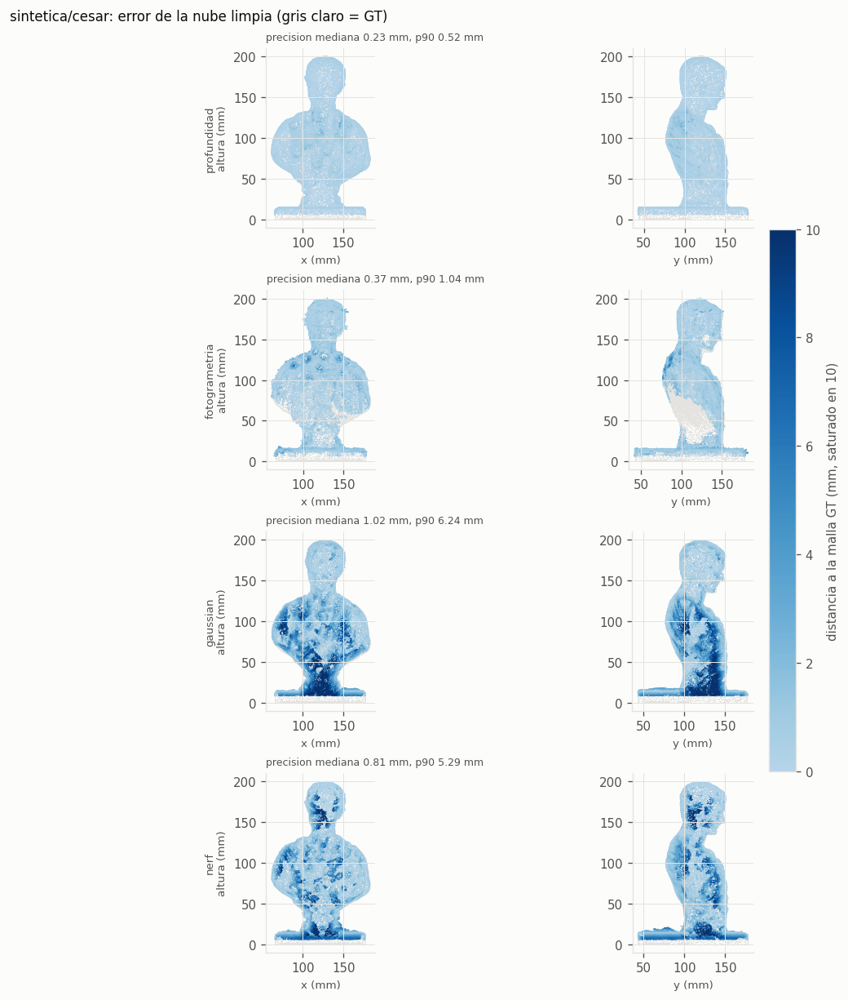

Nubes para MeshLab/CloudCompare: `Reconstrucciones/sintetica/cesar/evaluacion/<tecnica>_error.ply` (color = error) y `<tecnica>/resultado_limpio.ply`.
