# Evaluacion: reconstruccion vs ground truth

Generado 2026-11-18 16:40 con `./run.sh informe` a partir de `Reconstrucciones/*/*/evaluacion/metricas.json`. No editar a mano.

## Metodo

Todas las nubes estan en el marco del tablero ChArUco (mm). Antes de comparar, cada nube (`<tecnica>/resultado.ply`) se limpia igual para las 4 tecnicas (`recon/limpieza.py`, `configs/recon.yaml: limpieza`) y se guarda en `<tecnica>/resultado_limpio.ply`:

1. **ROI**: cilindro de radio 160 mm sobre el eje de la base.
2. **Piso**: plano del tablero ajustado con RANSAC (umbral 1.5 mm) en la propia nube, con los puntos con |z| < 10 mm de la corona exterior de la ROI (r > 0.75 R, donde nunca hay objeto). Si el ajuste es dudoso (inclinacion > 3 deg o a mas de 5 mm de z = 0) se usa z = 0. En la corona se mide el grosor del piso reconstruido (percentil 99 de la altura sobre el plano) y se quita todo lo que queda por debajo de **corte = max(5 mm, grosor + 1 mm)** (tope 10 mm).
3. **Outliers estadisticos**: distancia media a 20 vecinos > media + 2 sigma.
4. **Clusters flotantes**: DBSCAN (eps 4 mm sobre la nube a 1.5 mm); se descartan los clusters con menos del 2% de los puntos.

El GT es la malla del objeto colocada en la escena sintetica, muestreada uniformemente; la franja junto a su base (apoyada en el tablero, no observable) se excluye hasta la **misma altura del corte del piso de cada tecnica**, para no penalizar la completitud por el corte. En capturas reales el GT se registra una vez sobre la nube de profundidad (barrido de yaw + ICP) y esa pose sirve para todas las tecnicas.

Metricas (mm): **precision** = distancia de cada punto reconstruido a la malla GT; **completitud** = distancia de cada punto del GT (muestreado) a la nube; **chamfer** = media de ambas medias; **F@t** = media armonica de la fraccion de puntos con precision < t y de GT con completitud < t. *Sin ICP* = en las poses de la captura (lo que importa); *con ICP* = tras alinear la nube al GT (separa error de forma de error de registro).

`*` = perfil rapido (pocas iteraciones; solo valida el flujo, no comparable).

## Resumen

Chamfer sin ICP (mm, menor = mejor):

| captura | profundidad | fotogrametria | gaussian | nerf |
|---|---:|---:|---:|---:|
| real/bunnny | 1.67 | 3.84 | 3.76 | 3.13 |
| sintetica/artefacto_pi2 | 0.29 | 2.10 | 1.50 | 1.04 |
| sintetica/bunnny | 0.26 | 1.86 | 3.07 | 1.70 |
| sintetica/caesar | 0.92 | 4.00 | 2.64 | 2.46 |
| sintetica/sneaker | 0.74 | 1.93* | 3.18* | 2.02* |

F-score a 2 mm sin ICP (mayor = mejor):

| captura | profundidad | fotogrametria | gaussian | nerf |
|---|---:|---:|---:|---:|
| real/bunnny | 0.732 | 0.405 | 0.370 | 0.385 |
| sintetica/artefacto_pi2 | 1.000 | 0.651 | 0.784 | 0.859 |
| sintetica/bunnny | 0.996 | 0.791 | 0.643 | 0.818 |
| sintetica/caesar | 0.913 | 0.665 | 0.631 | 0.726 |
| sintetica/sneaker | 0.923 | 0.787* | 0.379* | 0.722* |

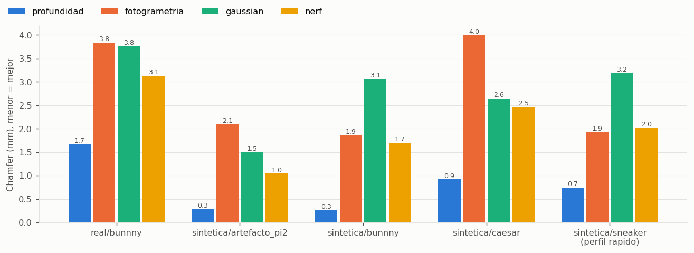

## real/bunnny

GT: `Captura_sintetica/bunnny/gt/objeto_rev.ply`; registrado sobre profundidad (fitness 0.65, rmse 0.96 mm)

| tecnica | pts ROI | corte piso | piso % | outl. % | flot. % | pts limpios | precision med | precision p90 | complet. med | complet. p90 | chamfer | hausdorff p95 | F@1mm | F@2mm | F@5mm | chamfer c/ICP | ICP mueve |
|---|---:|---:|---:|---:|---:|---:|---:|---:|---:|---:|---:|---:|---:|---:|---:|---:|---:|
| profundidad | 281795 | 5.0 | 49.6 | 0.1 | 1.0 | 138796 | 0.97 | 4.93 | 0.97 | 3.61 | 1.67 | 6.48 | 0.509 | 0.732 | 0.925 | 1.68 | 0.1 |
| fotogrametria | 258162 | 5.0 | 58.1 | 0.6 | 0.3 | 105877 | 2.35 | 4.92 | 2.73 | 13.54 | 3.84 | 20.43 | 0.201 | 0.405 | 0.803 | 2.35 | 5.0 |
| gaussian | 239340 | 5.2 | 57.7 | 0.5 | 0.8 | 97886 | 3.15 | 10.26 | 2.62 | 6.18 | 3.76 | 13.56 | 0.185 | 0.370 | 0.743 | 2.65 | 4.8 |
| nerf | 274728 | 5.0 | 47.3 | 0.2 | 0.0 | 144012 | 2.85 | 7.48 | 2.39 | 4.82 | 3.13 | 11.05 | 0.184 | 0.385 | 0.859 | 2.00 | 5.0 |

Plano del tablero ajustado por tecnica:

- profundidad: corte 5.0 mm (grosor del piso 0.6 mm), plano ransac, inclinacion 0.03 deg, z=0 a +3.24 mm del plano, rms 0.36 mm
- fotogrametria: corte 5.0 mm (grosor del piso 1.9 mm), plano ransac, inclinacion 0.05 deg, z=0 a -0.25 mm del plano, rms 0.67 mm
- gaussian: corte 5.2 mm (grosor del piso 4.2 mm), plano ransac, inclinacion 0.54 deg, z=0 a -2.02 mm del plano, rms 0.84 mm
- nerf: corte 5.0 mm (grosor del piso 2.1 mm), plano ransac, inclinacion 0.38 deg, z=0 a -0.97 mm del plano, rms 0.79 mm

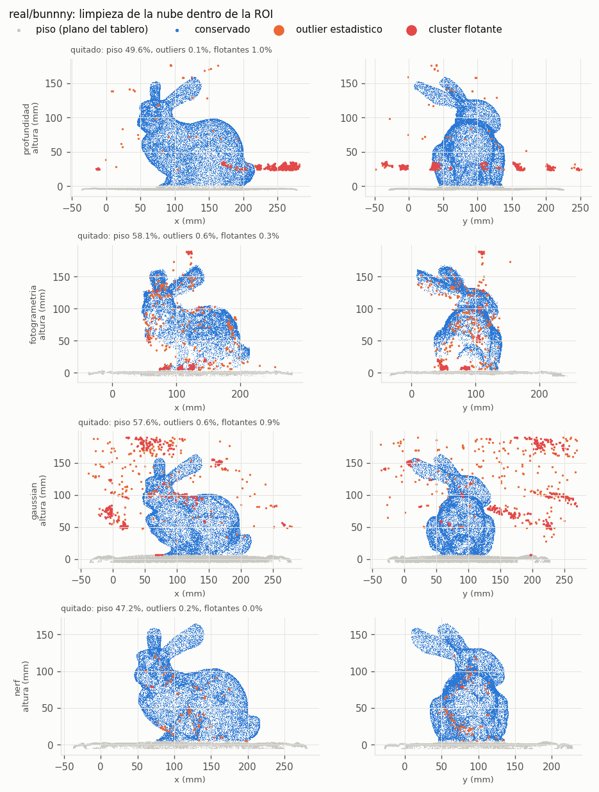

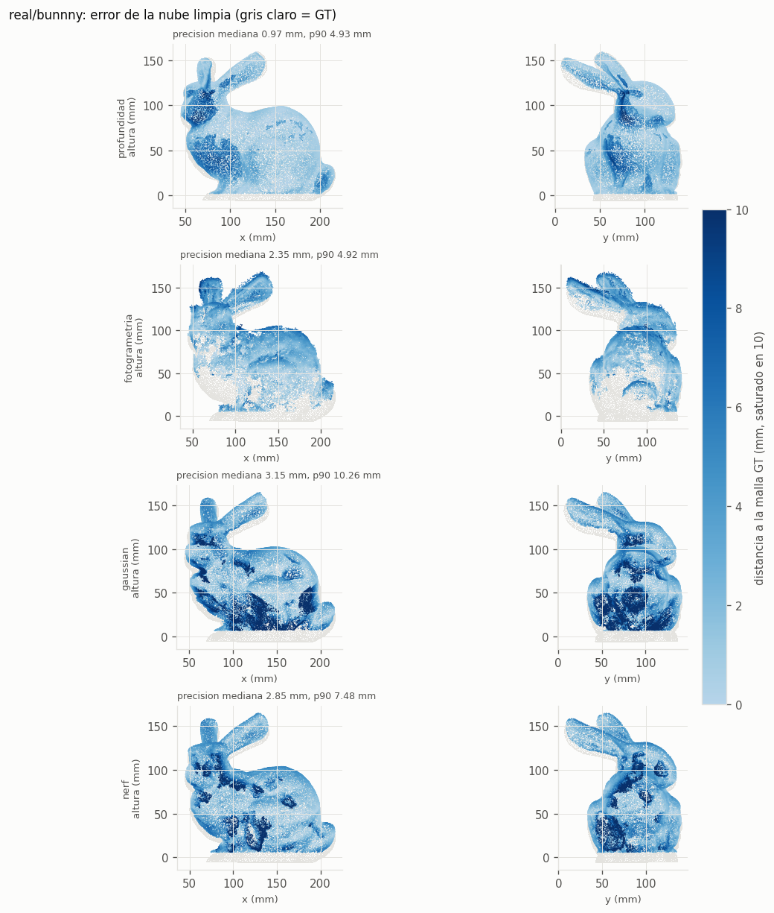

Nubes para MeshLab/CloudCompare: `Reconstrucciones/real/bunnny/evaluacion/<tecnica>_error.ply` (color = error) y `<tecnica>/resultado_limpio.ply`.

## sintetica/artefacto_pi2

GT: `Captura_sintetica/artefacto_pi2/gt/objeto_rev.ply`

| tecnica | pts ROI | corte piso | piso % | outl. % | flot. % | pts limpios | precision med | precision p90 | complet. med | complet. p90 | chamfer | hausdorff p95 | F@1mm | F@2mm | F@5mm | chamfer c/ICP | ICP mueve |
|---|---:|---:|---:|---:|---:|---:|---:|---:|---:|---:|---:|---:|---:|---:|---:|---:|---:|
| profundidad | 278475 | 5.0 | 68.1 | 0.8 | 0.0 | 86779 | 0.13 | 0.43 | 0.34 | 0.65 | 0.29 | 0.81 | 0.985 | 1.000 | 1.000 | 0.27 | 0.2 |
| fotogrametria | 182179 | 5.0 | 70.5 | 0.4 | 0.0 | 53008 | 1.16 | 3.55 | 1.41 | 6.58 | 2.10 | 9.12 | 0.406 | 0.651 | 0.906 | 2.02 | 0.9 |
| gaussian | 237432 | 5.0 | 68.4 | 0.7 | 12.0 | 44922 | 0.92 | 3.32 | 1.11 | 3.45 | 1.50 | 4.90 | 0.488 | 0.784 | 0.958 | 1.28 | 1.1 |
| nerf | 283435 | 5.0 | 68.4 | 0.7 | 0.0 | 87589 | 0.65 | 2.56 | 0.72 | 2.32 | 1.04 | 3.51 | 0.665 | 0.859 | 0.993 | 0.97 | 0.5 |

Plano del tablero ajustado por tecnica:

- profundidad: corte 5.0 mm (grosor del piso 0.2 mm), plano ransac, inclinacion 0.03 deg, z=0 a -0.03 mm del plano, rms 0.29 mm
- fotogrametria: corte 5.0 mm (grosor del piso 2.0 mm), plano ransac, inclinacion 0.07 deg, z=0 a -1.09 mm del plano, rms 0.62 mm
- gaussian: corte 5.0 mm (grosor del piso 3.1 mm), plano ransac, inclinacion 0.25 deg, z=0 a -3.15 mm del plano, rms 0.78 mm
- nerf: corte 5.0 mm (grosor del piso 3.5 mm), plano ransac, inclinacion 0.08 deg, z=0 a -0.26 mm del plano, rms 0.50 mm

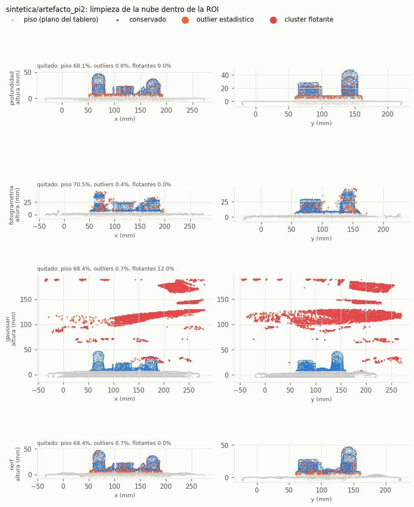

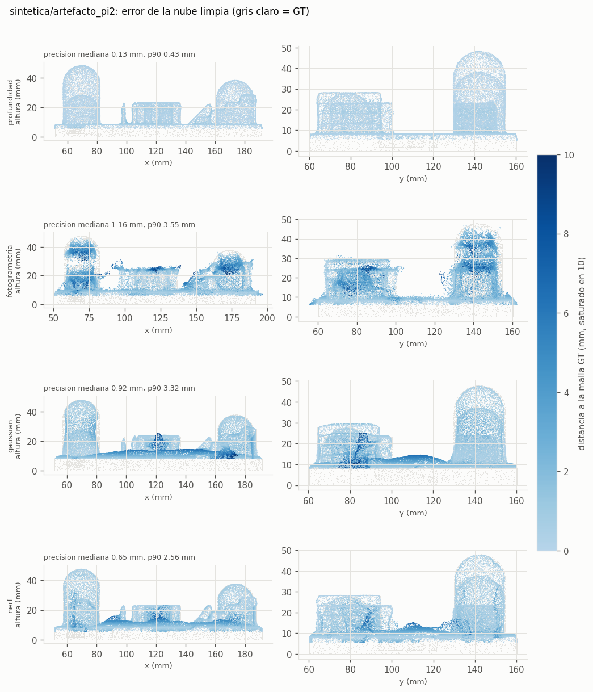

Nubes para MeshLab/CloudCompare: `Reconstrucciones/sintetica/artefacto_pi2/evaluacion/<tecnica>_error.ply` (color = error) y `<tecnica>/resultado_limpio.ply`.

## sintetica/bunnny

GT: `Captura_sintetica/bunnny/gt/objeto_rev.ply`

| tecnica | pts ROI | corte piso | piso % | outl. % | flot. % | pts limpios | precision med | precision p90 | complet. med | complet. p90 | chamfer | hausdorff p95 | F@1mm | F@2mm | F@5mm | chamfer c/ICP | ICP mueve |
|---|---:|---:|---:|---:|---:|---:|---:|---:|---:|---:|---:|---:|---:|---:|---:|---:|---:|
| profundidad | 286692 | 5.0 | 52.3 | 0.8 | 0.0 | 134655 | 0.11 | 0.26 | 0.34 | 0.57 | 0.26 | 0.65 | 0.993 | 0.996 | 0.998 | 0.25 | 0.2 |
| fotogrametria | 220659 | 5.0 | 46.5 | 1.4 | 0.6 | 113610 | 0.53 | 1.88 | 0.87 | 8.49 | 1.86 | 13.45 | 0.623 | 0.791 | 0.907 | 1.86 | 0.2 |
| gaussian | 254793 | 5.0 | 36.3 | 0.4 | 29.1 | 86941 | 1.53 | 13.42 | 1.09 | 3.59 | 3.07 | 17.43 | 0.410 | 0.643 | 0.814 | 3.05 | 0.2 |
| nerf | 268208 | 5.0 | 50.9 | 0.6 | 0.3 | 129256 | 0.90 | 5.91 | 0.86 | 2.14 | 1.70 | 9.34 | 0.569 | 0.818 | 0.934 | 1.63 | 0.7 |

Plano del tablero ajustado por tecnica:

- profundidad: corte 5.0 mm (grosor del piso 0.2 mm), plano ransac, inclinacion 0.02 deg, z=0 a -0.07 mm del plano, rms 0.26 mm
- fotogrametria: corte 5.0 mm (grosor del piso 1.7 mm), plano ransac, inclinacion 0.09 deg, z=0 a -0.76 mm del plano, rms 0.54 mm
- gaussian: corte 5.0 mm (grosor del piso 3.3 mm), plano ransac, inclinacion 0.21 deg, z=0 a -3.35 mm del plano, rms 0.76 mm
- nerf: corte 5.0 mm (grosor del piso 3.9 mm), plano ransac, inclinacion 0.01 deg, z=0 a -0.55 mm del plano, rms 0.61 mm

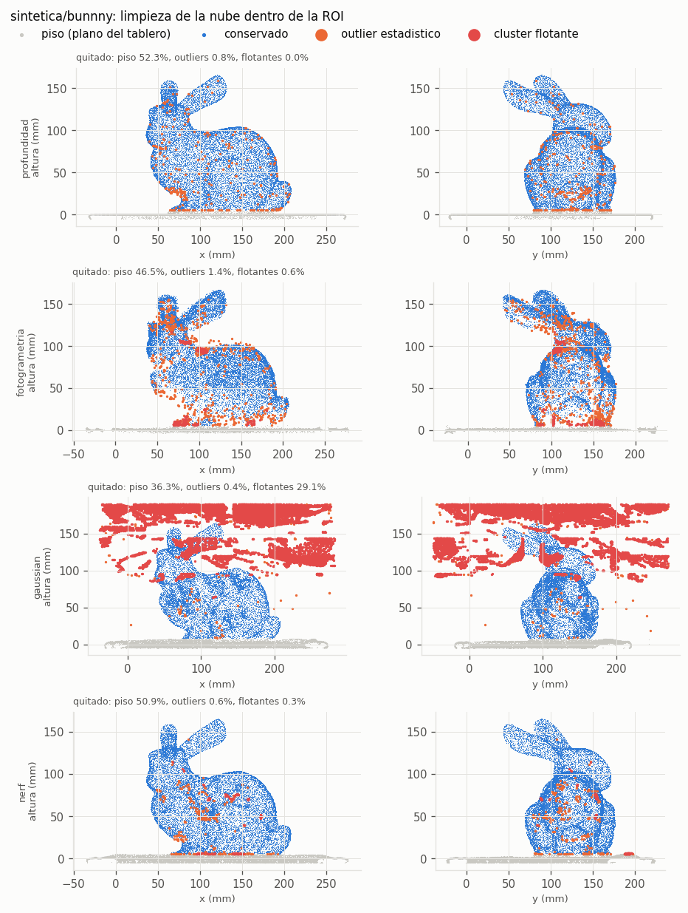

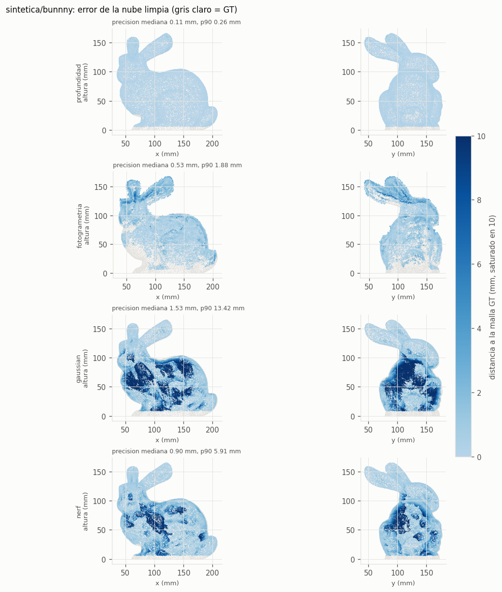

Nubes para MeshLab/CloudCompare: `Reconstrucciones/sintetica/bunnny/evaluacion/<tecnica>_error.ply` (color = error) y `<tecnica>/resultado_limpio.ply`.

## sintetica/caesar

GT: `Captura_sintetica/caesar/gt/objeto_rev.ply`

| tecnica | pts ROI | corte piso | piso % | outl. % | flot. % | pts limpios | precision med | precision p90 | complet. med | complet. p90 | chamfer | hausdorff p95 | F@1mm | F@2mm | F@5mm | chamfer c/ICP | ICP mueve |
|---|---:|---:|---:|---:|---:|---:|---:|---:|---:|---:|---:|---:|---:|---:|---:|---:|---:|
| profundidad | 287565 | 5.0 | 44.9 | 0.8 | 0.2 | 155340 | 0.20 | 0.46 | 0.45 | 5.11 | 0.92 | 9.45 | 0.887 | 0.913 | 0.946 | 0.87 | 0.3 |
| fotogrametria | 211713 | 5.0 | 45.4 | 1.7 | 0.2 | 111719 | 0.35 | 1.02 | 1.95 | 22.60 | 4.00 | 26.06 | 0.581 | 0.665 | 0.742 | 3.96 | 0.4 |
| gaussian | 258891 | 5.0 | 39.9 | 0.3 | 23.7 | 93432 | 1.02 | 6.69 | 1.28 | 8.30 | 2.64 | 10.83 | 0.450 | 0.631 | 0.822 | 2.64 | 0.1 |
| nerf | 294190 | 5.0 | 41.5 | 0.7 | 0.2 | 169559 | 0.75 | 4.18 | 0.97 | 12.24 | 2.46 | 15.73 | 0.551 | 0.726 | 0.847 | 2.46 | 0.3 |

Plano del tablero ajustado por tecnica:

- profundidad: corte 5.0 mm (grosor del piso 0.2 mm), plano ransac, inclinacion 0.01 deg, z=0 a -0.18 mm del plano, rms 0.28 mm
- fotogrametria: corte 5.0 mm (grosor del piso 1.5 mm), plano ransac, inclinacion 0.02 deg, z=0 a -0.60 mm del plano, rms 0.51 mm
- gaussian: corte 5.0 mm (grosor del piso 2.4 mm), plano ransac, inclinacion 0.24 deg, z=0 a -3.39 mm del plano, rms 0.82 mm
- nerf: corte 5.0 mm (grosor del piso 3.0 mm), plano ransac, inclinacion 0.20 deg, z=0 a -0.63 mm del plano, rms 0.62 mm

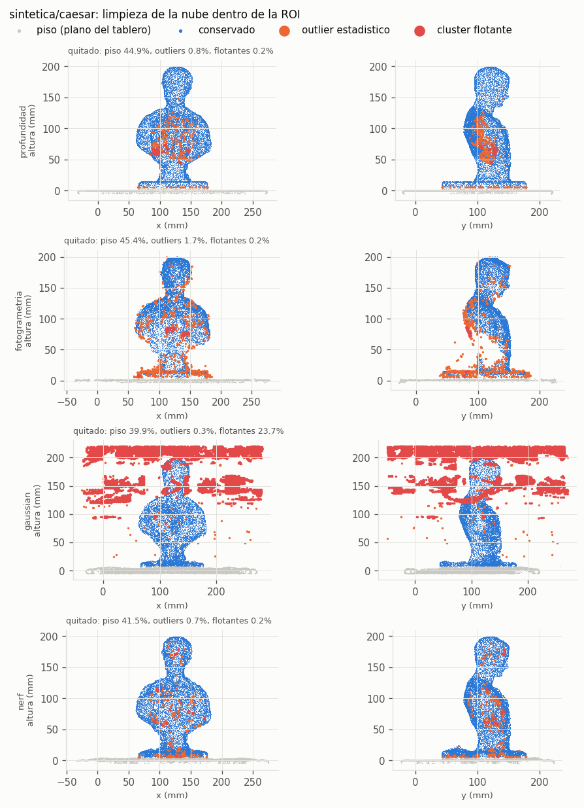

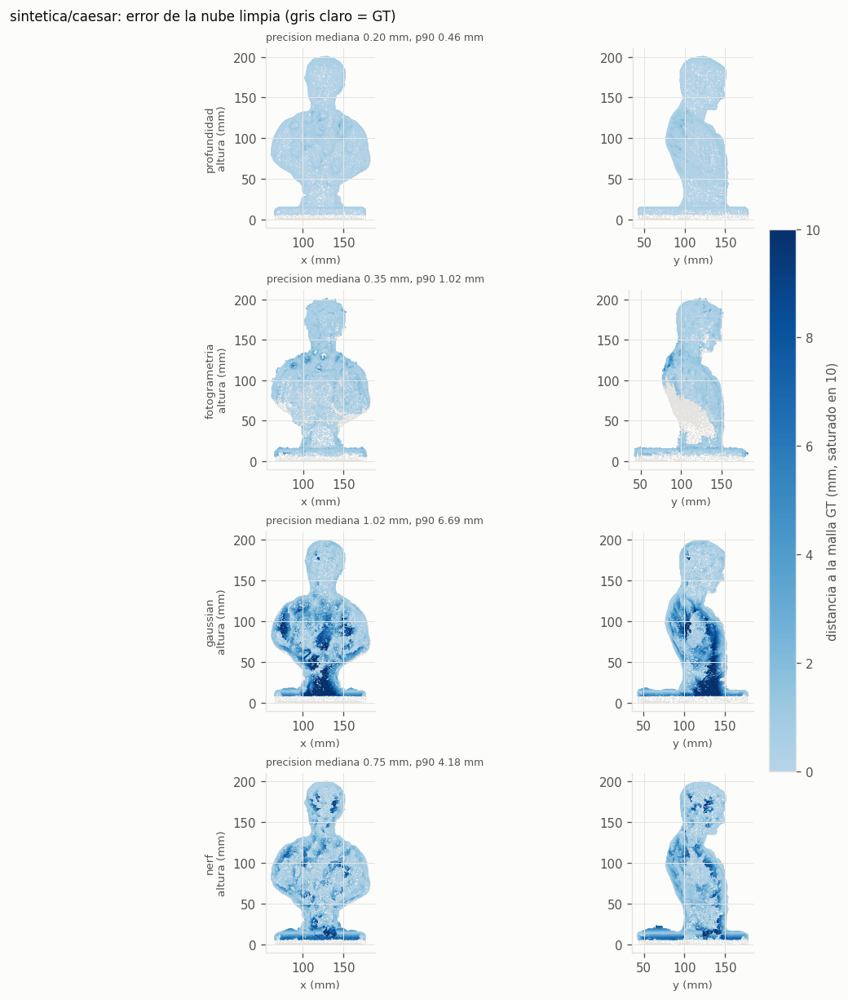

Nubes para MeshLab/CloudCompare: `Reconstrucciones/sintetica/caesar/evaluacion/<tecnica>_error.ply` (color = error) y `<tecnica>/resultado_limpio.ply`.

## sintetica/sneaker

GT: `Captura_sintetica/sneaker/gt/objeto_rev.ply`

| tecnica | pts ROI | corte piso | piso % | outl. % | flot. % | pts limpios | precision med | precision p90 | complet. med | complet. p90 | chamfer | hausdorff p95 | F@1mm | F@2mm | F@5mm | chamfer c/ICP | ICP mueve |
|---|---:|---:|---:|---:|---:|---:|---:|---:|---:|---:|---:|---:|---:|---:|---:|---:|---:|
| profundidad | 283294 | 5.0 | 67.2 | 0.7 | 0.0 | 91078 | 0.19 | 1.10 | 0.48 | 1.83 | 0.74 | 3.66 | 0.839 | 0.923 | 0.977 | 0.73 | 0.2 |
| fotogrametria* | 44863 | 5.0 | 77.7 | 0.2 | 0.1 | 9870 | 0.54 | 1.82 | 1.31 | 7.84 | 1.93 | 12.27 | 0.454 | 0.787 | 0.890 | 1.82 | 1.2 |
| gaussian* | 223951 | 7.2 | 69.0 | 0.1 | 1.1 | 66627 | 2.43 | 7.71 | 2.45 | 5.51 | 3.18 | 9.41 | 0.130 | 0.379 | 0.825 | 2.84 | 5.4 |
| nerf* | 221995 | 5.0 | 70.5 | 0.1 | 0.1 | 65202 | 0.82 | 6.77 | 0.92 | 4.56 | 2.02 | 9.59 | 0.538 | 0.722 | 0.885 | 2.03 | 0.5 |

Plano del tablero ajustado por tecnica:

- profundidad: corte 5.0 mm (grosor del piso 0.2 mm), plano ransac, inclinacion 0.03 deg, z=0 a -0.05 mm del plano, rms 0.31 mm
- fotogrametria: corte 5.0 mm (grosor del piso 3.7 mm), plano ransac, inclinacion 0.08 deg, z=0 a -1.47 mm del plano, rms 0.57 mm
- gaussian: corte 7.2 mm (grosor del piso 6.2 mm), plano ransac, inclinacion 0.66 deg, z=0 a -0.11 mm del plano, rms 0.84 mm
- nerf: corte 5.0 mm (grosor del piso 3.3 mm), plano ransac, inclinacion 0.25 deg, z=0 a -0.95 mm del plano, rms 0.72 mm

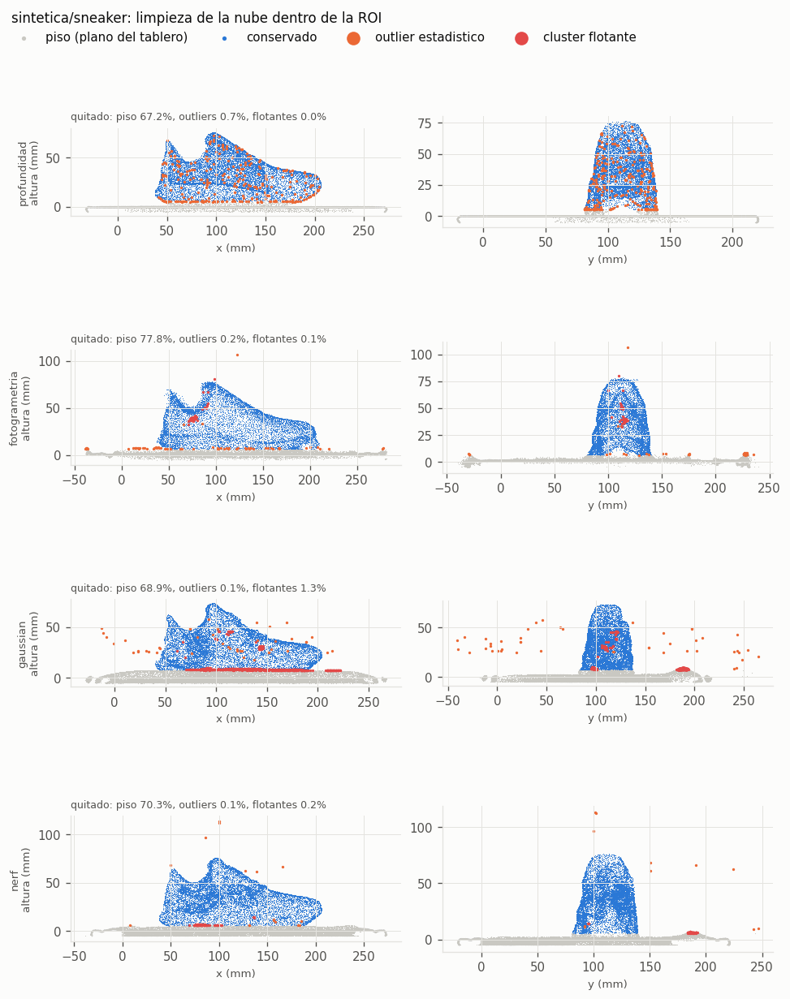

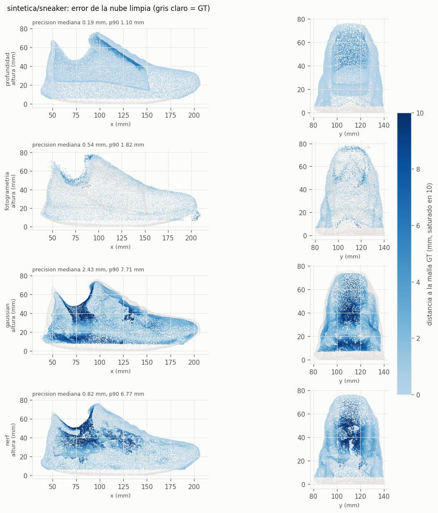

Nubes para MeshLab/CloudCompare: `Reconstrucciones/sintetica/sneaker/evaluacion/<tecnica>_error.ply` (color = error) y `<tecnica>/resultado_limpio.ply`.
